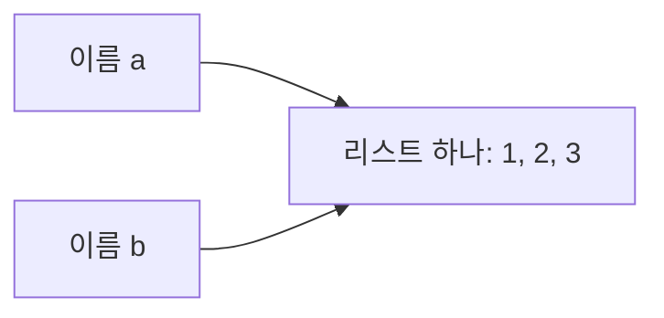
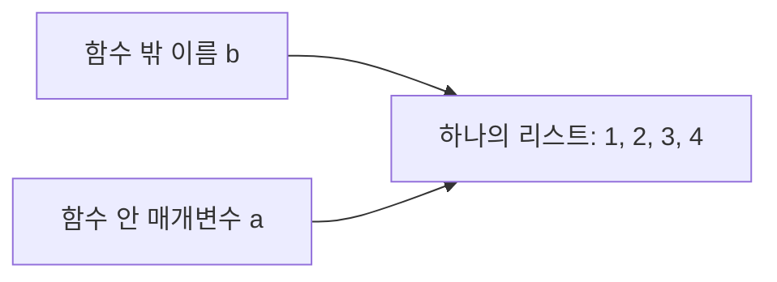

# 변수와 참조 — 같은 리스트가 함께 바뀌는 이유

[00 과목 목차](README.md) · [장별 연습문제](실습/연습문제/01_메모리와_참조_연습문제.md)

리스트를 다른 변수에 넣었는데 한쪽을 수정하자 양쪽 출력이 바뀌었다. 함수는 아무것도 반환하지 않았는데 바깥 리스트가 바뀌기도 한다. 이 장에서는 이 현상을 **이름이 가리키는 대상·객체의 내용·함수의 반환값**으로 나누어 읽는다. 이 셋을 구별하면 코드를 다시 보았을 때 ‘주소 때문’이라는 말에 기대지 않고 결과를 직접 설명할 수 있다.

<a id="chapter-toc"></a>

**이 장의 목차**

1. [이번 장에서 배울 것과 실행 조건](#learn)
2. [개념부터 이해하기](#concepts) — 이름·객체·변경·재할당
3. [작은 예제와 결과](#small-example) — 직접 실행하고 한 줄 바꾸기
4. [내 코드 따라 읽기](#my-code) — 대입·복사·함수의 원본 풀이
5. [다른 파일과 연결하기](#connections) — 새 복습 함수의 정의와 import
6. [내 코드 돌아보기](#review) — 주석 교정과 함수의 의도
7. [강사님 코드에서 배울 점](#teacher) — 반환값이 달라지는 경우
8. [결과와 확인 방법](#results) — 상태 추적과 경계 사례
9. [추가로 알면 좋은 것](#tips) — Stack·Heap·중첩 복사
10. [복습과 다음 학습](#practice) — 단계별 문제와 빠른 확인표

표시 읽기: **내 코드 · 원본 발췌**는 실제 수업 파일, **설명용 새 예제**는 책을 위한 재구성, **개선 예시**는 원본에 적용하지 않은 제안이다. **📚 출처 · 본문 설명 확인**은 배운 코드의 설명을 검증한 외부 근거이며, **💡 TIP · 수업 범위 밖**은 선택 학습이다.

<a id="learn"></a>

## 1. 이번 장에서 배울 것

Python의 변수·리스트·인덱스·함수를 배운 뒤 읽는 연결 자료다. 아직 함수 전이라면 2~4절의 리스트 예제를 먼저 보고 함수 예제는 함수 수업 뒤 다시 읽어도 된다. 번호가 00이라고 HTML 전에 외워야 하는 선행 과목은 아니다.

이 장을 읽은 뒤에는 다음을 설명할 수 있어야 한다.

- `b = a`가 리스트를 복제하는지, 두 이름의 관계가 어떻게 되는지
- `b.append(4)`와 `b = [4]`가 왜 다른 결과를 만드는지
- `copy()` 뒤 `is`와 `==`의 결과를 어떻게 읽는지
- `return` 없이도 원본이 바뀌는 이유와 함수가 돌려준 값
- 원본을 바꿀 함수와 새 결과를 만들 함수 중 무엇을 택할지

### 1.1 원본과 실행 예제의 위치

| 자료 | 실제 기준 위치 | 이 장에서의 역할 |
| --- | --- | --- |
| 내 리스트 수업 | `D:/workspace/workspace_python/04_list.py` | 대입·복사·동일성 비교·주석 |
| 내 함수 수업 | `D:/workspace/workspace_python/11_fn.py` | `ref(a)`와 호출 |
| 강사님 대응 수업 | `D:/workspace_teacher/workspace_python/_04_list.py`, `_11_fn.py` | 같은 동작 확인과 반환값 차이 비교 |
| 새 함수 모듈 | [실습/reference_tools.py](실습/reference_tools.py) | 입력 변경 함수와 복사 후 반환 함수 |
| 새 실행 파일 | [실습/참조_복습.py](실습/참조_복습.py) | 모듈을 import해 결과를 출력 |

원본 기준일은 2026-10-28이다. 원본 파일은 여러 실험과 변수 재사용이 이어져 있으므로 전체 실행의 마지막 상태를 임의로 특정 발췌의 시작 상태로 삼지 않는다. **각 예제는 새 리스트에서 시작**한다.

### 1.2 직접 실행하기

Python 3만 있으면 되고 추가 패키지·DB·인터넷 연결은 필요 없다. 실행 파일과 `reference_tools.py`를 같은 `실습` 폴더에 둔다. 이 폴더에서 터미널을 열고 다음 명령을 실행한다.

```powershell
python 참조_복습.py
```

결과는 터미널에 나온다. 독립 실행 예제 전체는 3절, import한 함수의 구현은 5절에 있다. **원본 발췌는 표시된 부분을 읽는 자료**이며, 함수 정의·호출 중 어느 부분을 생략했는지 확인한 뒤 실행한다. 코드에서 보이는 `A`, `B` 같은 객체 표식은 설명용이며 실제 메모리 주소가 아니다.

<a id="concepts"></a>
<a id="names"></a>
<a id="index-section-225"></a>
<a id="index-section-139"></a>
<a id="index-section-175"></a>

## 2. 개념부터 이해하기

### 2.1 이름과 객체는 무엇인가?

`a = [1, 2, 3]`을 한 덩어리로 외우지 말고 두 부분으로 읽자. `[1, 2, 3]`은 실제로 다룰 **리스트 객체**이고, `a`는 그 객체를 사용할 **이름**이다. 이름이 어떤 객체를 가리키는 관계를 이 장에서는 참조라고 표현한다.

`b = a`를 실행하면 `a`가 가리키는 객체를 이름 `b`로도 사용할 수 있다. 이 대입문에는 새 리스트를 만들라는 동작이 없다. 따라서 이름은 두 개지만 리스트는 하나다.



화살표 두 개는 같은 리스트로 향한다. `b[0]`을 바꾸면 그 하나의 리스트 내용이 바뀌므로, 이후 `a`로 확인해도 바뀐 내용을 본다. ‘두 리스트가 동시에 수정된다’고 이해하면 객체가 몇 개인지 놓치게 된다.

> 📚 **출처 · 본문 설명 확인:** 대입이 객체 복사가 아니라 이름과 객체의 연결을 만든다는 설명은 [Python — copy](https://docs.python.org/3/library/copy.html)로 확인했다. 이 절에서는 수업의 `b = a`를 설명하는 데 필요한 범위만 사용한다.

### 2.2 변경과 재할당을 구별하기

**변경**은 기존 리스트 안의 값을 추가·교체·삭제하는 일이다. **재할당**은 이름이 다른 객체를 가리키도록 다시 정하는 일이다. 결과를 판단할 때는 등호가 있는지뿐 아니라, 등호 왼쪽이 이름 자체인지 요소 자리인지도 본다.

| 문장 | 무엇에 작용하는가? | 읽는 방법 |
| --- | --- | --- |
| `b = a` | 이름 `b` | `a`의 객체를 함께 가리킴 |
| `b[0] = 10` | 기존 리스트의 요소 자리 | 리스트 내용 변경 |
| `b.append(4)` | 기존 리스트 | 마지막에 요소 추가 |
| `b = [4]` | 이름 `b` | 새 리스트를 만들어 `b`를 연결 |
| `b = a.copy()` | 새 바깥 리스트와 이름 `b` | 복사본을 만들고 그쪽에 연결 |

`b[0] = 10`은 `b`라는 이름의 연결을 바꾸지 않는다. `b`가 가리키는 리스트의 0번 요소를 바꾼다. 반대로 `b = [4]`는 기존 리스트를 비우거나 고치는 명령이 아니다. 이름 `b`가 새 리스트를 가리키게 한다.

<a id="rebind"></a>
<a id="index-section-299"></a>
<a id="index-section-51"></a>

### 2.3 `clear()`와 빈 리스트 대입이 같아 보이는 이유

이름 하나만 출력하면 두 방법 모두 `[]`가 나올 수 있다. 하지만 다른 이름도 기존 리스트를 사용하고 있다면 차이가 드러난다.

```python
# 설명용 새 예제 · 각 경우를 새 리스트로 시작
a = [1, 2, 3]
b = a
a.clear()
print(a, b)

a = [1, 2, 3]
b = a
a = []
print(a, b)
```

확인한 출력:

```text
[] []
[] [1, 2, 3]
```

첫 경우는 기존 리스트를 비웠다. `b`도 그 리스트를 가리키므로 빈 리스트가 보인다. 둘째 경우는 이름 `a`만 새 빈 리스트로 옮겼다. 이름 `b`는 기존 리스트를 계속 가리킨다. **`a`의 화면 출력만 같은 것과 전체 상태가 같은 것은 다르다.**

### 2.4 값이 같은가, 같은 객체인가?

`==`는 이 예제의 리스트 값이 같은 순서로 같은 요소를 가지는지 비교한다. `is`는 두 이름이 같은 객체를 가리키는지 확인한다. 별도 리스트 두 개가 같은 숫자를 담으면 값은 같아도 객체는 다르다.

| 질문 | 확인할 표현 | 복사 직후의 예 |
| --- | --- | --- |
| 내용이 같은가? | `a == b` | `True`일 수 있음 |
| 같은 객체인가? | `a is b` | `a.copy()`로 새 바깥 리스트를 만들면 `False` |

여기서 `is`를 배우는 목적은 리스트의 공유 여부를 확인하는 것이다. 숫자나 문자열의 일반적인 값 비교까지 `is`로 바꾸는 규칙으로 외우지 않는다.

> 📚 **출처 · 본문 설명 확인:** 객체의 동일성과 `is`의 의미는 [Python 데이터 모델 — 객체·값·타입](https://docs.python.org/3/reference/datamodel.html#objects-values-and-types)로 확인했다. 식별값의 실제 숫자나 저장 위치를 알아야 이 예제를 풀 수 있는 것은 아니다.

<a id="small-example"></a>

## 3. 작은 예제와 결과

### 3.1 가장 작은 공유 예제

**설명용 새 예제 · 독립 실행 가능.** `append()`를 적용할 대상이 하나인지 먼저 확인하자.

```python
a = [1, 2]
b = a
b.append(3)
print(a)
print(b)
print(a is b)
```

확인한 출력:

```text
[1, 2, 3]
[1, 2, 3]
True
```

첫 대입에서 리스트를 하나 만들고 두 번째 대입에서 같은 객체에 이름만 추가했다. `append(3)`은 그 리스트의 내용을 바꾼다. 마지막 `True`는 두 출력이 우연히 같은 숫자를 보였다는 뜻보다 강한 확인이다. 두 이름이 실제로 같은 객체를 보고 있다.

### 3.2 한 줄만 바꿔 비교하기

위 코드의 **`b = a` 한 줄만 `b = a.copy()`로 바꾸고**, 처음부터 새로 실행해 보자.

```python
# 설명용 새 예제 · 앞 예제의 상태를 이어받지 않음
a = [1, 2]
b = a.copy()
b.append(3)
print(a)
print(b)
print(a is b)
```

확인한 출력:

```text
[1, 2]
[1, 2, 3]
False
```

| 바꾼 한 줄 | `append`가 바꾼 대상 | 원본 `a` | `a is b` |
| --- | --- | --- | --- |
| `b = a` | 공유하던 리스트 | 함께 바뀜 | `True` |
| `b = a.copy()` | 새 바깥 리스트 | 그대로 | `False` |

두 예제 모두 `append`를 썼다. 결과를 가른 것은 메서드 이름이 아니라 **어느 객체에 적용했는지**다. 이 질문을 함수 안에서도 그대로 사용한다.

### 3.3 제공된 실행 파일로 확인하기

[실습/참조_복습.py](실습/참조_복습.py)는 아래 전체 코드다. 5절에서 정의를 읽을 두 함수를 import한다. `reference_tools.py`도 같은 폴더에 둔다.

```python
"""책의 설명용 새 예제. 같은 폴더의 reference_tools.py와 함께 실행한다."""

from reference_tools import append_in_place, with_added_item

original = [1, 2]
same = original
copied = original.copy()
same.append(3)
copied[0] = 9
print('original:', original)
print('same is original:', same is original)
print('copied:', copied)

numbers = [1, 2]
result = append_in_place(numbers, 3)
print('changed:', numbers)
print('returned:', result)

numbers = [1, 2]
result = with_added_item(numbers, 3)
print('kept:', numbers)
print('new:', result)
```

확인한 출력:

```text
original: [1, 2, 3]
same is original: True
copied: [9, 2]
changed: [1, 2, 3]
returned: None
kept: [1, 2]
new: [1, 2, 3]
```

앞의 세 줄은 공유와 복사, 뒤의 네 줄은 함수가 입력을 바꾸는지와 무엇을 반환하는지를 보여 준다. `None`이 출력됐다고 앞의 리스트 추가까지 실행되지 않은 것은 아니다. 그 차이를 원본에서 확인하자.

<a id="my-code"></a>
<a id="alias"></a>
<a id="index-section-616"></a>

## 4. 내 코드 따라 읽기

### 4.1 대입 뒤 세 번째 요소 바꾸기

**내 코드 · 원본 발췌** — `workspace_python/04_list.py` 120–124행.

```python
a = [1,2,3,4,5]
b = a # 이렇게 넣으면 a = b의 주소값이 동일해지기 때문에, index값을 바꾸면 두개가 모두 바뀜
b[2] = 30
print(b)
print(a)
```

`b[2]`의 인덱스 2는 세 번째 요소다. 이 코드는 리스트를 두 개 만들지 않았으므로 `b[2] = 30`이 공유 리스트 한 개를 바꾼다. 강사님 대응 코드도 실행문은 같아 이 부분은 별도 중복 인용 없이 동작이 같음을 확인한다.

확인한 출력:

```text
[1, 2, 30, 4, 5]
[1, 2, 30, 4, 5]
```

| 실행한 문장 | 이름 관계 | 그때 리스트 내용 |
| --- | --- | --- |
| `a = [1,2,3,4,5]` | `a` → A | A: `[1, 2, 3, 4, 5]` |
| `b = a` | `a`, `b` → A | A 그대로 |
| `b[2] = 30` | 두 이름 모두 A | A: `[1, 2, 30, 4, 5]` |

내 주석의 ‘두 개가 모두 바뀜’은 두 객체를 뜻하는 말처럼 보일 수 있다. ‘같은 리스트 하나를 두 이름으로 확인하므로 두 출력에 같은 변경이 보임’으로 설명하면 객체 수를 정확히 이해할 수 있다.

<a id="copy"></a>
<a id="section-8"></a>

### 4.2 복사한 뒤 세 번째 요소 바꾸기

**내 코드 · 원본 발췌** — `workspace_python/04_list.py` 126–130행.

```python
a = [1,2,3,4,5]
b = a.copy() # copy를 이용하면 모든 요소를 아예 복사해오기 때문에, 이럴 땐 주소값이 달라져 개별 값만 바꿔짐
b[2] = 30
print(b)
print(a)
```

이제 `a.copy()`에서 바깥 리스트를 새로 만든다. 그 새 리스트를 `b`로 사용하므로 `b[2]`를 교체해도 `a`의 세 번째 요소는 3이다.

확인한 출력:

```text
[1, 2, 30, 4, 5]
[1, 2, 3, 4, 5]
```

여기서 주석의 ‘모든 요소를 아예 복사’는 안쪽 객체까지 전부 새로 만든다는 뜻으로 확대하면 안 된다. `copy()`는 **얕은 복사**라 바깥 리스트가 새로 생기고 그 요소로 사용할 객체의 참조를 담는다. 이번 숫자 리스트에서는 바깥 요소 교체만 하므로 원본을 보존한다. 중첩 리스트의 안쪽 변경은 9절의 보충에서 별도로 확인한다.

<a id="section-4"></a>

### 4.3 같은 값과 같은 객체를 원본에서 확인하기

**내 코드 · 원본 발췌** — `workspace_python/04_list.py` 132–135행.

```python
a = [1,2,3,4,5]
b = a.copy() 
print( a is b ) # False (주소값이 다르기 때문에 주소까지 전부 같지 않음)
print( a == b ) # True (안에 있는 값은 같음)
```

확인한 출력:

```text
False
True
```

첫 번째는 별도 바깥 리스트이므로 `False`, 두 번째는 같은 순서로 같은 숫자를 담았으므로 `True`다. 복사 직후의 값이 같은 것은 복사가 실패한 증거가 아니다. **같은 시작 내용을 가진 별도 리스트가 필요해서 복사**하는 것이다.

<a id="function"></a>
<a id="index-section-32"></a>

### 4.4 `return`이 없는 내 함수

**내 코드 · 원본 발췌** — `workspace_python/11_fn.py` 116–121행.

```python
def ref(a) :
    a.append(4)

b = [1,2,3]
ref(b) # 전달인자 또는 =으로 가게되면 stack의 주소값이 들어감 + 원본 변경
print(b)
```

확인한 출력:

```text
[1, 2, 3, 4]
```

함수 정의의 `a`는 입력을 받을 **매개변수**이고, `ref(b)`에서 넘기는 `b`는 실제 전달할 객체를 가리킨다. 호출할 때 함수 안의 이름 `a`도 같은 리스트를 사용한다. `a.append(4)`가 그 리스트를 바꾸므로 바깥 이름 `b`로도 결과를 볼 수 있다.



그림은 함수 실행 중의 관계다. 함수가 끝나도 바깥 `b`가 리스트를 계속 가리킨다. 함수가 반환하지 않았다는 이유로 이미 한 변경이 취소되지 않는다.

내 주석의 ‘stack의 주소값이 들어감’은 특정 저장 위치를 단정한다. 이 코드의 결과를 설명할 때는 **매개변수도 같은 객체를 가리킨다**는 관계로 충분하다. ‘메모리 어딘가의 주소를 외운다’와 ‘객체 공유를 추적한다’를 구별한다.

> 📚 **출처 · 본문 설명 확인:** 매개변수와 호출, 명시적인 반환이 없는 함수의 `None` 반환은 [Python 자습서 — 함수 정의](https://docs.python.org/3/tutorial/controlflow.html#defining-functions)로 확인했다. 이 절의 실제 변경은 수업 원본의 `append()`에서 일어난다.

<a id="connections"></a>

## 5. 다른 파일과 연결하기

원본 두 수업 파일은 이 발췌에서 서로 import하지 않는다. 리스트 실험과 함수 실험을 각각 작성한 기록이다. 아래 두 파일 연결은 **배운 개념을 다시 쓰기 위해 새로 구성한 복습**이다.

### 5.1 가져올 함수는 어떻게 정의돼 있는가?

[실습/reference_tools.py](실습/reference_tools.py)의 전체 내용은 다음과 같다.

```python
"""설명용 새 모듈. 한 단계 리스트의 입력 변경과 새 결과를 비교한다."""


def append_in_place(items, item):
    items.append(item)


def with_added_item(items, item):
    new_items = items.copy()
    new_items.append(item)
    return new_items
```

| 함수 | 입력 | 실제 변경 대상 | 반환값 |
| --- | --- | --- | --- |
| `append_in_place(items, item)` | 리스트와 추가할 값 | 전달받은 리스트 | `None` |
| `with_added_item(items, item)` | 리스트와 추가할 값 | 새로 만든 바깥 리스트 | 그 새 리스트 |

`with_added_item`의 첫 줄에서 새 바깥 리스트를 만들어 `new_items`에 연결한다. 두 번째 줄의 `append`는 그 복사본에 적용된다. 원본을 남겨 두려는 의도와 실제 변경 대상이 맞는지 확인할 수 있다.

### 5.2 import 뒤 호출이 이어지는 순서

실행 파일은 `from reference_tools import append_in_place, with_added_item`으로 함수 두 개를 사용할 준비를 한다. 이 예에서 가져오는 것은 함수이며, 함수를 정의했다고 그 안의 `append`가 실행되지는 않는다.

```text
참조_복습.py 실행
  → reference_tools.py에서 함수 정의를 가져옴
  → 호출할 리스트를 준비
  → append_in_place(numbers, 3) 호출
  → 같은 리스트에 3 추가 → 반환값 None
  → 실행 파일에서 원본 리스트와 반환값을 각각 출력
```

`print`는 실행 파일에 있고 실제 리스트 처리는 함수 모듈 안에 있다. 그래서 반환값·입력 변경을 따로 기록하면 import한 함수도 안이 보이는 코드처럼 읽을 수 있다.

> 📚 **출처 · 본문 설명 확인:** 모듈에서 정의한 함수를 다른 파일에서 가져오는 방식은 [Python 자습서 — 모듈](https://docs.python.org/3/tutorial/modules.html)로 확인했다. 이 두 파일의 구체적인 이름과 함수 조합은 새 복습 예제다.

<a id="review"></a>
<a id="comments"></a>

## 6. 내 코드 돌아보기

### 6.1 잘한 점

내 리스트 수업에는 대입, 복사, `is`·`==` 확인이 이어져 있다. 결과를 출력하는 데서 멈추지 않고 **같은 객체인지와 같은 값인지**를 직접 비교했다는 점이 좋다. 한 줄을 바꾸고 관계를 확인하는 습관은 실제 오류를 좁힐 때도 도움이 된다.

함수 예제는 `append` 하나로 입력 변경을 드러낸다. 복잡한 조건을 섞지 않아 변경 원인을 찾기 쉽다. 명시적 반환이 없다는 사실은, 입력을 수정하는 함수라는 의도에 맞는다면 그 자체로 오류가 아니다.

### 6.2 무엇을 교정하고 무엇을 선택할까?

| 원본의 표현·선택 | 평가 종류 | 더 정확하게 읽는 방법 |
| --- | --- | --- |
| `b = a` 뒤 두 개가 모두 바뀜 | 설명 보완 | 리스트 하나를 두 이름으로 확인 |
| `copy()`로 모든 요소를 아예 복사 | 설명 보완 | 바깥 리스트의 얕은 복사; 안쪽 객체 공유 가능 |
| `clear()`와 `a = []`는 동일하게 사용 | 조건 누락 | 다른 이름이 공유할 때 결과가 다름 |
| 함수에서 Stack 주소가 전달됨 | 설명 보완 | 매개변수와 호출 쪽 이름이 같은 객체를 사용 |
| `ref`에 명시적 반환문 없음 | 의도에 따른 선택 | 입력 변경만 목표라면 성립; 새 결과가 필요하면 별도 설계 |

내 원본 04_list.py 101행에는 `a.clear()`와 빈 리스트 대입을 같은 것으로 설명한 주석이 있다. 원본 주석을 지우지 않고, **공유한 이름이 있는지 확인해야 한다**는 조건을 이 책에 보완한다. 코드를 평가할 때 실행 오류와 짧은 학습 메모의 불완전함을 구별한다.

### 6.3 배운 문법으로 의도를 드러내기

같은 처리라도 요구사항은 두 가지일 수 있다.

- **원본을 바꿔야 한다:** 전달받은 리스트에 추가하고, 호출자는 그 리스트를 계속 사용한다.
- **원본을 보존해야 한다:** 바깥 리스트를 복사한 뒤 복사본을 바꾸고 반환값을 받아 사용한다.

5절의 두 함수가 각각의 개선 예시다. 새로운 문법으로 짧게 줄이는 것이 목적이 아니라 **원본 유지라는 요구사항과 실제 동작을 맞추는 것**이 목적이다. 숫자만 있는 이 예제에는 배운 `copy()`로 충분하며, 무조건 깊은 복사를 도입하지 않는다.

[실무 코딩스타일](02_메모리와_참조_실무_코딩스타일.md)에서는 함수 사용자가 입력 변경을 예상할 수 있게 이름·설명·호출 결과를 함께 쓰는 방법을 연습한다.

<a id="teacher"></a>

## 7. 강사님 코드에서 배울 점

대입과 복사는 강사님과 내 실행문이 같아 두 블록을 반복할 필요가 없다. **반환값이 실제로 다른 함수 부분만** 인용한다.

**강사님 코드 · 비교에 필요한 발췌** — `workspace_python/_11_fn.py` 120–126행.

```python
def ref(a) :
    a.append(4)
    return a

b = [1,2,3]
ref(b)
print(b)
```

강사님은 같은 리스트를 수정한 뒤 `return a`로 그 리스트를 반환한다. 내 함수도 수정은 하지만 명시적인 반환문이 없어 `None`을 반환한다. 두 원본은 반환값을 변수에 받지 않으므로 원본의 `print(b)`만 보면 차이를 알기 어렵다.

강사님 발췌의 확인한 출력:

```text
[1, 2, 3, 4]
```

**설명용 새 예제 · 반환값만 비교하도록 함수 이름 재구성.** 각 경우는 새 리스트로 시작한다.

```python
def returned(items):
    items.append(4)
    return items


def changed_only(items):
    items.append(4)


numbers = [1, 2, 3]
result = returned(numbers)
print(numbers)
print(result is numbers)

numbers = [1, 2, 3]
result = changed_only(numbers)
print(numbers)
print(result)
```

확인한 출력:

```text
[1, 2, 3, 4]
True
[1, 2, 3, 4]
None
```

강사님 방식은 호출 결과로도 수정한 같은 리스트를 쓰려는 경우 참고할 수 있다. 하지만 **반환했다는 이유로 새 리스트가 된 것은 아니다.** 원본을 보존해야 한다면 `return a`만 추가할 것이 아니라 수정 대상을 바꾸어야 한다.

| 원하는 동작 | 참고할 구조 |
| --- | --- |
| 입력 리스트를 수정 | 내 함수의 변경 동작도 목적에 맞음 |
| 수정한 같은 리스트를 반환값으로도 제공 | 강사님 `return a` 참고 |
| 원본 유지 + 새 결과 제공 | 5절의 복사 후 반환 예시 |

<a id="results"></a>

## 8. 결과와 확인 방법

### 8.1 출력·반환·원본 상태를 나눠 기록

다음 세 칸을 따로 적으면 함수가 `None`을 돌려줬다는 이유로 처리까지 실패했다고 오해하지 않는다.

| 확인할 것 | 질문 | 내 원본 `ref(b)` |
| --- | --- | --- |
| 원본 상태 | 호출 후 `b`는 무엇인가? | `[1, 2, 3, 4]` |
| 반환값 | 호출 결과를 변수에 받으면? | `None` |
| 출력 | 어느 줄에서 화면에 보이는가? | 원본의 `print(b)` |

### 8.2 함수 안에서 이름만 바꾸는 경우

**설명용 새 예제 · 독립 실행 가능.** 함수의 기존 리스트를 수정하는 대신 매개변수 이름을 새 리스트에 연결한다.

```python
def replace(items):
    items = [4]
    print(items)


numbers = [1, 2, 3]
replace(numbers)
print(numbers)
```

확인한 출력:

```text
[4]
[1, 2, 3]
```

함수 안 이름 `items`만 새 리스트로 연결했다. 바깥 `numbers`가 가리키는 기존 리스트를 수정하지 않았다. 함수가 끝나면서 변경이 취소된 것이 아니라, 처음부터 바깥 리스트에 대한 변경이 없었던 것이다.

### 8.3 경계 사례와 흔한 오해

| 시작 조건·시도 | 결과 | 먼저 확인할 것 |
| --- | --- | --- |
| 빈 리스트를 `append_in_place([], 3)`에 전달 | 전달한 리스트에 3이 추가되고 반환값은 `None` | 빈 리스트에서도 추가는 가능 |
| 원본 `[1, 1]`에서 복사 후 0번 요소만 교체 | 원본은 그대로 | 값의 중복과 객체 공유는 다른 질문 |
| `result = numbers.append(3)` | `numbers`는 변경, `result`는 `None` | 메서드의 반환값을 원본 리스트로 착각했는가? |
| 함수 안에서 `items = [...]`만 실행 | 바깥 이름의 리스트는 유지 | 내용 변경과 이름 재할당을 혼동했는가? |
| 복사 뒤 안쪽 리스트 변경 | 양쪽에서 변경이 보일 수 있음 | 9절의 얕은 복사 범위 확인 |

마지막 행은 보충 개념을 포함하므로 기본 복습의 필수 조건으로 요구하지 않는다. 먼저 한 단계 리스트에서 이름의 연결을 정확히 그린다.

### 8.4 검증 범위

이 장의 독립 Python 예제와 제공된 새 실행 파일, 표시한 원본 발췌를 Python 3.12.14에서 분리 실행해 출력과 상태를 확인했다. 원본 파일 전체를 순서대로 실행한 기록과 구별한다. 같은 숫자 `id()` 값, 객체의 실제 주소, 메모리 회수 시점을 재현하는 검사는 하지 않는다.

<a id="tips"></a>
<a id="index-section-114"></a>
<a id="index-section-163"></a>
<a id="section-11"></a>

## 9. 추가로 알면 좋은 것

<a id="extra-01-1"></a>

### 9.1 Stack·Heap 그림은 어디까지 믿어야 할까?

> 💡 **TIP · 수업 범위 밖:** 파일명에 Stack·Heap이 있어도 이 장의 기본 목표는 실제 저장 공간을 해부하는 것이 아니다. 일반적인 함수 호출·복귀를 Stack의 쌓고 꺼내는 모습으로 설명할 수 있지만, ‘Python 이름은 무조건 Stack, 값은 무조건 Heap’이라고 언어 규칙처럼 외우지 않는다.

이 책의 화살표는 **관계 그림**이다. 실행 환경의 물리적인 메모리 배치를 그리지 않는다. 리스트를 끝에 넣고 끝에서 꺼내는 자료구조 Stack과 함수 호출을 설명할 때의 Stack도 문맥에 따라 구별해야 한다.

<a id="extra-01-2"></a>

### 9.2 함수가 끝난 뒤 객체는 언제 사라질까?

> 💡 **TIP · 수업 범위 밖:** 함수 실행이 끝나는 시점과 그 함수에서 사용한 객체가 모두 사라지는 시점은 같은 개념이 아니다. 바깥 이름이 계속 객체를 사용하면 함수가 끝난 뒤에도 그 객체에 접근할 수 있다.

CPython의 참조 카운트와 순환 참조 처리는 구현에 관한 추가 학습이다. 이번 코드에서는 참조 횟수를 손으로 계산하거나 정확한 회수 시각을 추측할 필요가 없다. [출처: Python 데이터 모델 — 객체 수명과 구현별 차이](https://docs.python.org/3/reference/datamodel.html#objects-values-and-types).

<a id="extra-01-3"></a>

### 9.3 `id()`의 숫자는 외워야 할까?

> 💡 **TIP · 수업 범위 밖:** `id()`는 객체의 식별값을 반환한다. 실행마다 같은 숫자를 기대하지 않는다. CPython의 구현 설명을 모든 Python 구현의 저장 규칙으로 일반화하지 않는다. 본문의 공유 여부 확인에는 이미 배운 `is`가 쓰였다. [출처: Python 내장 함수 — id](https://docs.python.org/3/library/functions.html#id).

<a id="extra-01-4"></a>

### 9.4 얕은 복사에서 안쪽 리스트를 바꾸면?

> 💡 **TIP · 기존 문법을 조합한 보충 실험:** 원본의 ‘모든 요소를 복사’라는 주석을 정확히 이해하려면 바깥 리스트 복사와 안쪽 객체 변경을 구분하면 좋다. 다음은 원본 발췌가 아니라 새로 구성한 중첩 리스트 예제다.

```python
a = [[1, 2], [3, 4]]
b = a.copy()
b[0].append(9)
print(a)
print(b)
print(a is b)
print(a[0] is b[0])
```

확인한 출력:

```text
[[1, 2, 9], [3, 4]]
[[1, 2, 9], [3, 4]]
False
True
```

바깥 리스트는 두 개지만 그 안에 든 첫 리스트는 공유한다. `b[0].append(9)`는 공유한 안쪽 객체를 바꾸므로 양쪽에서 보인다. 반면 `b[0] = [9]`는 복사한 바깥 리스트의 0번 요소를 다른 리스트로 교체하므로 원본의 0번 요소는 유지된다.

```text
a → 바깥 리스트 A → 첫 요소 ─┐
                            ├→ 안쪽 리스트 [1, 2, 9]
b → 바깥 리스트 B → 첫 요소 ─┘
```

안쪽까지 복사하는 방법으로 `copy.deepcopy()`를 추가 학습할 수 있다. **다음 import와 함수는 수업 밖 기능**이다. 단순한 숫자 리스트의 요소를 바꾸는 기본 예제에 반드시 필요한 도구는 아니다.

```python
# 설명용 새 예제 · 수업 밖의 깊은 복사
import copy

a = [[1, 2], [3, 4]]
b = copy.deepcopy(a)
b[0].append(9)
print(a)
print(b)
print(a[0] is b[0])
```

확인한 출력:

```text
[[1, 2], [3, 4]]
[[1, 2, 9], [3, 4]]
False
```

이 간단한 중첩 숫자 리스트에서는 안쪽도 별도 객체가 된다. 어떤 객체든 모든 관계가 무조건 독립된다는 일반 법칙으로 확대하지 않는다. 필요한 복사 범위와 객체 종류를 먼저 판단한다. [출처: Python — 얕은 복사와 깊은 복사](https://docs.python.org/3/library/copy.html).

<a id="extra-01-5"></a>

기본 문제는 이름의 공유·내용 변경·재할당·한 단계 리스트 복사·반환값 구분만으로 풀 수 있다. Stack·Heap, 회수 시점, 깊은 복사를 먼저 외우지 않아도 된다.

<a id="practice"></a>

## 10. 복습과 다음 학습

### 10.1 결과 예상

다음 새 문제에서 세 줄을 먼저 예상한다. 시작 자료는 매번 새로 만든다.

```python
a = [10, 20]
b = a
c = a.copy()
b[0] = 99
print(a)
print(c)
print(c is a)
```

<details>
<summary>정답과 이유</summary>

```text
[99, 20]
[10, 20]
False
```

`b`는 같은 리스트를 바꾸고 `c`는 별도 바깥 리스트를 유지한다. `False`는 값의 비교가 아니라 객체의 동일성 비교 결과다.

</details>

### 10.2 이유 설명과 작은 수정

‘원본은 유지하고 새 목록을 얻는다’는 요구사항인데 함수가 입력에 바로 `append`한다면 `return items`만 붙여도 해결될까? 출력 숫자보다 **수정한 대상이 어디인지**로 답해 보자.

<details>
<summary>풀이</summary>

반환문을 추가해도 이미 원본을 바꾼 사실은 남는다. 바깥 리스트를 먼저 복사하고 복사본에 추가한 뒤 그 결과를 반환해야 한다. 5절의 `with_added_item`이 이 요구사항에 맞는다. 반환과 변경은 별도 동작이다.

</details>

더 많은 단계별 문제는 [장별 연습문제](실습/연습문제/01_메모리와_참조_연습문제.md), 여러 동작을 한 번에 추적하는 과제는 [종합실습](03_메모리와_참조_종합실습.md)에서 이어 푼다.

<a id="summary"></a>
<a id="section-14"></a>

### 10.3 빠른 확인표

| 필요한 동작 | 선택할 구조 | 원본 변경 | 결과 확인 |
| --- | --- | --- | --- |
| 같은 목록을 함께 사용 | `b = a` | 변경 시 공유 이름에서 보임 | `a is b` |
| 새 바깥 목록을 사용 | `b = a.copy()` | 바깥 요소 교체는 원본 유지 | 값과 동일성을 따로 비교 |
| 기존 목록 비우기 | `a.clear()` | 공유 목록도 비워짐 | 다른 이름에서 확인 |
| 이름만 새 빈 목록으로 옮기기 | `a = []` | 기존 목록은 다른 이름으로 남을 수 있음 | 관계 그림 |
| 함수가 입력 수정 | `items.append(...)` | 있음 | 호출 후 입력을 출력 |
| 새 결과 생성 | 복사·변경·`return new_items` | 이 한 단계 예제는 없음 | 반환값을 변수에 받아 출력 |

<a id="index-section-47"></a>
<a id="index-section-52"></a>
<a id="index-section-635"></a>
<a id="index-section-636"></a>
<a id="section-7-3"></a>

### 10.4 다음 학습과 용어 연결

변수의 재할당은 Python 변수 장, 리스트 메서드의 사용은 리스트 장, 매개변수와 반환은 함수 장에서 다시 읽는다. 이 장은 그 사이를 연결한다. 예전 색인에서 자료형·반복문·경로를 찾았다면 [Python 목차](../04_Python/README.md)나 [HTML 목차](../01_HTML/README.md)의 해당 주제로 이동한다.

| 용어 | 이 장의 의미 |
| --- | --- |
| 이름 | 객체에 접근할 때 사용하는 변수 이름 |
| 객체 | 프로그램에서 다루는 값의 실체 |
| 변경 | 기존 객체의 내용 수정 |
| 재할당 | 이름이 가리키는 대상 다시 지정 |
| 반환값 | 함수 호출 결과로 돌려받은 값 |
| 얕은 복사 | 바깥 컨테이너를 새로 만들고 요소의 객체는 공유할 수 있는 복사 |

### 10.5 출처

수업 범위는 1절의 실제 원본과 사용자 확인을 기준으로 한다. BACKUP의 리스트 설명은 **정의→문법→예제→출력→이유** 전개를 참고했고, 실제 수업 코드처럼 인용하지 않았다. 외부 문서는 2026-10-28 확인했으며 해당 설명 옆에 링크를 붙였다. 외부 문장을 그대로 옮긴 직접 인용은 없다.

- [Python 자습서 — 리스트](https://docs.python.org/3/tutorial/introduction.html#lists): 리스트 변경과 대입 설명 확인
- [Python 자습서 — 함수](https://docs.python.org/3/tutorial/controlflow.html#defining-functions): 매개변수·호출·반환 설명 확인
- [Python 자습서 — 모듈](https://docs.python.org/3/tutorial/modules.html): 새 복습 파일의 import 연결 확인
- [Python — copy](https://docs.python.org/3/library/copy.html): 대입과 복사, 보충의 깊은 복사 확인
- [Python 데이터 모델](https://docs.python.org/3/reference/datamodel.html#objects-values-and-types): 동일성과 객체 수명의 근거

**이 장을 읽은 뒤:** [장별 문제 풀기](실습/연습문제/01_메모리와_참조_연습문제.md) → [종합실습](03_메모리와_참조_종합실습.md) → [실무 코딩스타일](02_메모리와_참조_실무_코딩스타일.md)
