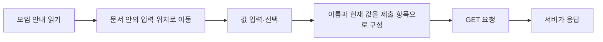

# 10. HTML 종합실습 — 복습 모임 안내와 참여 입력

[HTML 목차](README.md) · [작성 스타일](09_HTML_실무_코딩스타일.md)

이 장은 **새로 구성한 종합실습**이다. 수업에서 쓴 문서 구조·목록·표·링크·폼을 하나의 문서로 연결한다. 원본 시험을 옮긴 것이 아니다. 안내를 읽고 참여 내용을 입력하는 연습 페이지이며, 실제 신청을 저장하는 서비스는 아니다.

<a id="chapter-toc"></a>

**이 장의 순서:** [목표](#goals) → [실행 조건](#setup) → [요구사항](#tasks) → [힌트](#hints) → [정답](#solution) → [결과와 풀이](#trace) → [변경·오류](#changes) → [추가 학습과 복습](#review).

<a id="goals"></a>

## 1. 이번 실습에서 연결할 것

태그 이름을 기억하는 것에서 한 단계 더 나아가 **내용의 역할에 맞게 태그를 고르고, 입력 상태에서 제출값을 계산**한다. 모든 줄을 외워 다시 쓰는 것이 목표가 아니다. 파일을 덮어 놓고도 ‘이 태그를 왜 썼는가?’와 ‘값 하나를 바꾸면 무엇이 달라지는가?’를 설명할 수 있으면 된다.

| 만들 부분 | 배운 내용 | 스스로 확인할 질문 |
| --- | --- | --- |
| 문서·본문 제목 | head, title, body, h1 | 탭과 본문에 무엇이 보이는가? |
| 준비물·진행 순서 | ul, ol, li | 항목의 순서가 의미를 가지는가? |
| 일정 | table, caption, thead, tbody | 제목 셀과 데이터 셀을 구분했는가? |
| 입력 위치로 이동 | a, href, id | 목적지 ID가 정확히 존재하는가? |
| 참여 정보 | label, input, select, textarea | 화면 글자와 제출 이름·값을 구분했는가? |
| 제출·초기화 | GET, submit, reset | 현재 상태와 처음 상태를 구분했는가? |



이 예제에는 입력값을 저장하는 서버 함수가 없다. 마지막 응답이 돌아온다는 것만으로 참여 등록이 저장되었다고 판단할 수 없다.

<a id="setup"></a>

## 2. 파일과 실행 조건

완성 예제는 [목록·표·폼 복습 HTML](실습/목록_표_폼_GET제출_복습.html)이다. GitHub에서는 코드를 읽고, 직접 확인할 때는 파일을 내려받아 연다. 화면과 문서 내부 이동은 파일로 열어 볼 수 있다. **GET 요청 주소는 Live Server처럼 이미 사용하던 로컬 HTTP 서버로 이 파일을 연 뒤 확인**한다. 서버가 보여 준 주소를 그대로 사용한다. 포트 번호를 외워 적을 필요는 없다.

| 확인 단계 | 필요한 조건 | 여기서 알 수 있는 것 |
| --- | --- | --- |
| 소스 읽기 | 텍스트 편집기 | 문서 구조·초기 속성 |
| 화면 열기 | 브라우저 | 표시·입력·내부 이동 |
| 제출 관찰 | HTTP로 제공되는 HTML | 주소의 쿼리, 요청·응답 |
| 실제 신청 저장 | 별도 서버 기능 필요 | 이 예제에서는 구현하지 않음 |

정답의 `border="1"`은 셀 경계를 관찰하려는 수업 방식이다. HTML 표를 만드는 핵심 속성은 아니며 실제 화면 스타일은 CSS에서 다룬다. 이번 실습은 외부 이미지나 JavaScript 파일 없이 실행할 수 있다.

<a id="tasks"></a>

## 3. 정답을 보기 전에 작성하기

1. 탭 제목은 `HTML 복습 모임`, 본문 큰 제목은 `HTML 복습 모임 안내`로 만든다.
2. 준비물 두 개는 순서 없는 목록, 진행 단계 세 개는 번호 목록으로 만든다.
3. 일정은 ‘과목·시간’ 두 열과 데이터 두 행으로 만든다. 표 제목도 보여 준다.
4. 문서 위에 ‘참여 정보로 이동’ 링크를 만들고 아래 입력 제목으로 연결한다.
5. 이름은 `learner=student`, 주제는 `topic=table`이 선택되고 `topic=form`은 선택되지 않게 한다.
6. 참여 시간은 `session=am`을 초기 선택으로, 메모는 `memo=review`로 만든다.
7. 제출 버튼과 처음 상태로 돌리는 버튼을 구분한다. 처음 제출될 쿼리를 먼저 적는다.

**이해 확인:** 화면의 ‘오전’이 주소에도 그대로 제출될까? 두 체크박스의 name이 같으면 하나만 선택할 수 있을까? 답을 정한 뒤 작성한다.

<a id="hints"></a>

## 4. 막혔을 때 사용할 힌트

<details>
<summary>힌트 1 — 구조부터 만들기</summary>

head와 body를 나눈 뒤, body 안에 제목·목록·표·입력 순서로 큰 뼈대부터 만든다. ul·ol의 항목은 li 안에, 표의 셀은 tr 안에 넣는다. 코드 들여쓰기를 한 단계씩 맞추면 닫는 위치를 찾기 쉽다.

</details>

<details>
<summary>힌트 2 — 연결과 제출을 구분하기</summary>

href="#application"은 id="application"인 위치로 이동한다. label의 for는 입력의 id와 맞춘다. 제출 이름은 별도 name 속성이다. textarea의 초기 글자는 value 속성이 아니라 시작·끝 태그 사이에 적는다.

</details>

<details>
<summary>힌트 3 — 제출 항목 적기</summary>

이름이 있는 입력 중 현재 제출 가능한 것들을 문서 순서대로 쓴다. 체크박스는 선택된 것만 포함한다. select는 선택된 option의 value, textarea는 현재 글자가 들어간다. 같은 name의 체크박스 여러 개를 선택하면 같은 이름의 항목이 반복될 수 있다.

</details>

<a id="solution"></a>

## 5. 완성 예제

**새 설명 예제 · 전체 파일.** 다음 코드는 원본 발췌가 아니다. 앞 장에서 설명한 태그만 연결했다.

<details>
<summary>예시 정답 전체 보기</summary>

```html
<!DOCTYPE html>
<html lang="ko">
<head>
    <meta charset="UTF-8">
    <title>HTML 복습 모임</title>
</head>
<body>
    <h1>HTML 복습 모임 안내</h1>
    <p>목록·표·입력을 하나의 문서로 연결합니다.</p>
    <a href="#application">참여 정보로 이동</a>

    <h2>준비물</h2>
    <ul>
        <li>수업 코드</li>
        <li>브라우저</li>
    </ul>
    <h2>진행 순서</h2>
    <ol>
        <li>코드 읽기</li>
        <li>결과 예상하기</li>
        <li>실행해서 비교하기</li>
    </ol>

    <table border="1">
        <caption>복습 일정</caption>
        <thead>
            <tr><th>과목</th><th>시간</th></tr>
        </thead>
        <tbody>
            <tr><td>목록과 표</td><td>30분</td></tr>
            <tr><td>폼 전송</td><td>30분</td></tr>
        </tbody>
    </table>

    <h2 id="application">참여 정보</h2>
    <form method="get">
        <p>
            <label for="learner">이름</label>
            <input id="learner" name="learner" type="text" value="student">
        </p>
        <p>
            <label><input type="checkbox" name="topic" value="table" checked>표</label>
            <label><input type="checkbox" name="topic" value="form">폼</label>
        </p>
        <p>
            <label for="session">참여 시간</label>
            <select id="session" name="session">
                <option value="am" selected>오전</option>
                <option value="pm">오후</option>
            </select>
        </p>
        <p>
            <label for="memo">메모</label>
            <textarea id="memo" name="memo" rows="3" cols="30">review</textarea>
        </p>
        <button type="submit">제출 연습</button>
        <input type="reset" value="처음 상태로">
    </form>
</body>
</html>
```

</details>

태그를 다 입력한 뒤에는 에디터에서 보기 좋은지만 확인하지 말고, ‘준비물과 순서가 다르게 읽히는가 → 표 제목이 보이는가 → 링크가 입력 제목으로 가는가 → 각 라벨을 눌렀을 때 대상이 맞는가’ 순서로 확인한다. 표·폼을 복사하는 동안 닫는 태그를 빠뜨리기 쉽다.

<a id="trace"></a>

## 6. 결과를 따라가며 정답 풀이

초기 상태에서의 제출 항목은 다음과 같다. **코드 기준 예상**이며 이번 편집에서 실제 브라우저 제출을 재실행했다는 기록은 아니다.

| 대상 | 현재 상태 | 포함되는 항목 | 이유 |
| --- | --- | --- | --- |
| 이름 | student | learner=student | name과 현재 값이 있음 |
| 표 체크박스 | 선택 | topic=table | checked로 초기 선택 |
| 폼 체크박스 | 미선택 | 없음 | 체크되지 않음 |
| 참여 시간 | 오전 | session=am | 선택 option의 value |
| 메모 | review | memo=review | textarea의 현재 글자 |
| 버튼 | 제출·초기화 | 이름을 가진 항목 없음 | 이 예제의 버튼에는 name이 없음 |

```text
learner=student&topic=table&session=am&memo=review
```

‘오전’은 사용자에게 보여 주는 설명이다. 실제 값은 `am`이다. 버튼의 문구 ‘제출 연습’도 자동으로 제출 데이터가 되지 않는다. 브라우저는 입력 상태를 읽고 이름·값 항목을 구성한다. GET에서는 그 항목이 URL의 쿼리에 들어간다.

폼도 체크하고 오후로 바꾼 뒤 제출하면 다음을 예상한다.

```text
learner=student&topic=table&topic=form&session=pm&memo=review
```

체크박스는 여러 개를 고를 수 있다. 같은 이름의 radio가 한 그룹에서 하나를 고르는 것과 다르다. 초기화는 선택 변경과 입력 변경을 **문서에 지정한 초기 상태로** 되돌린다. 언제나 빈칸으로 만드는 버튼이라고 외우면 안 된다. 페이지를 다시 불러오거나 브라우저가 상태를 복원한 경우와 구분해, 한 번 열어 변경한 뒤 초기화하는 순서로 관찰한다.

**내 코드에서 가져온 판단:** [폼 장의 원본](07_HTML_폼과_입력요소.md#my-code)에서 선택지마다 value를 붙인 점은 제출값을 구별하는 데 유익했다. [표 장](05_HTML_테이블.md#review)의 hidden·summary 문제는 반복하지 않았다. 강사님 코드도 잘못된 summary 구조는 그대로 따라 쓰지 않는다. 같은 코드를 다시 인용하기보다 앞 장에서 확인한 판단을 이 결과물에 적용한다.

> 📚 **출처 · 본문 설명 확인:** [HTML 표준 — 제출 항목 구성](https://html.spec.whatwg.org/multipage/form-control-infrastructure.html)과 [폼 요소·초기화](https://html.spec.whatwg.org/multipage/form-elements.html). 문서 예제·제출값 표·풀이 순서는 새로 구성했다. 확인일: 2026-10-28.

<a id="changes"></a>

## 7. 한 가지씩 바꾸고, 실수의 원인을 찾기

여러 속성을 동시에 바꾸면 무엇 때문에 결과가 달라졌는지 알기 어렵다. 아래 실험은 **매번 원래 코드로 돌아간 뒤 한 조건만** 바꾼다.

| 변경 | 예상 | 확인할 원리 |
| --- | --- | --- |
| 이름 입력에서 name만 삭제 | learner 항목이 없어짐 | id가 있어도 제출 이름을 대신하지 않음 |
| 표의 value만 삭제 | 선택 시 topic=on | 체크박스 기본 제출값 |
| 표 체크를 해제 | topic 항목이 없어짐 | 다른 주제도 선택하지 않은 초기 조건 |
| submit을 button으로 변경 | 그 버튼 클릭만으로 폼이 제출되지 않음 | 버튼의 기본 행동 |
| 오전 option의 value를 morning으로 변경 | 초기 제출이 session=morning | 글자 ‘오전’과 값은 별개 |

| 겪을 수 있는 현상 | 원인 후보 | 돌아볼 곳 |
| --- | --- | --- |
| 내부 링크를 눌러도 목적지가 안 맞음 | href와 id 철자 불일치 | [경로·문서 내부 이동](03_HTML_링크와_경로.md) |
| 표는 보이는데 구조가 이상함 | 셀·행 닫는 태그 불일치 | [표](05_HTML_테이블.md) |
| 쿼리가 예상과 다름 | name·현재 선택·value 확인 누락 | [전송](07-02_HTML_폼_전송과_GET_POST.md) |
| 초기화 뒤 빈칸이 되지 않음 | 초기값을 지정한 예제임 | [입력 상태](07_HTML_폼과_입력요소.md) |
| 제출 후 저장된 목록이 안 보임 | 이 파일에 저장 기능이 없음 | 요청 구성과 서버 처리 구분 |

닫는 태그가 잘못된 것은 고칠 구조 오류다. 들여쓰기 네 칸 대신 두 칸을 일관되게 쓴 것은 형식 선택이다. 두 경우를 같은 수준의 오류로 평가하지 않는다.

<a id="review"></a>
<a id="extra-04-1"></a>

## 8. 추가로 알면 좋은 것과 복습 마무리

> 💡 **TIP · 수업 범위 밖:** 다음은 시맨틱 영역과 fieldset·legend·email·required를 더한 선택 과제다. 앞의 기본 과제를 마친 뒤 읽는다. required는 브라우저의 필수 입력 검사이지 서버에 값이 저장되었다는 표시가 아니다. 이메일 형식 검사도 실제 주소 소유자를 확인하는 기능은 아니다.

<a id="extra-04-2"></a>

**새 추가 예제 · 전체 파일.** [추가 실습 파일](실습/교육과정_추가실습.html)과 같다.

<details>
<summary>선택 확장 예제</summary>

```html
<!DOCTYPE html>
<html lang="ko">
<head>
    <meta charset="UTF-8">
    <title>참여 정보 추가 연습</title>
</head>
<body>
    <header><h1>참여 정보 추가 연습</h1></header>
    <main>
        <section>
            <h2>연락 정보</h2>
            <form method="get">
                <fieldset>
                    <legend>연습용 주소를 입력하세요</legend>
                    <label for="contact">이메일</label>
                    <input type="email" id="contact" name="contact" required>
                </fieldset>
                <button type="submit">검사와 제출 연습</button>
            </form>
        </section>
    </main>
    <footer><p>실제 신청을 받지 않는 학습 문서입니다.</p></footer>
</body>
</html>
```

</details>

fieldset은 관련 입력을 묶고 legend는 그 묶음의 제목을 제공한다. required가 있는 email 입력을 비운 채 제출하는 경우와 `student@example.com`을 넣는 경우를 비교한다. 실제 개인정보를 넣을 필요는 없다. 이 확장은 [시맨틱 태그](08_HTML_시맨틱태그와_페이지구조.md), [HTML 표준 — 입력 요소](https://html.spec.whatwg.org/multipage/input.html)·[폼 요소](https://html.spec.whatwg.org/multipage/form-elements.html)를 참고한다.

<a id="extra-04-3"></a>

**자기 점검:** ① 화면을 보지 않고 제출값을 예상했는가? ② 그 값이 되는 이유를 각 입력 속성으로 설명했는가? ③ 이름 하나를 지웠을 때 결과를 설명했는가? ④ 실제 확인과 코드 기준 예상을 구별했는가? 네 가지를 말할 수 있으면 이번 종합복습의 핵심을 이해한 것이다.

<a id="extra-04-4"></a>

| 빠르게 다시 찾기 | 읽을 곳 |
| --- | --- |
| 내용 역할과 표 구조 | 1·3·5절 |
| 실행 전제 | 2절 |
| 제출값 추적 | 6절 |
| 수정 실험과 오류 구분 | 7절 |
| 선택 확장 | 8절의 TIP |

[장별 연습문제](실습/연습문제/README.md)에서 약한 부분을 다시 풀고 [다음 과목 CSS](../02_CSS/README.md)로 이어 간다. HTML은 내용의 구조를 만들고 CSS는 그 구조가 보이는 방식을 다룬다.

<!-- 이전 색인에서 사용하는 이동 주소 보존 -->
<a id="html-12"></a>
<a id="html-24"></a>
<a id="html-29"></a>
<a id="html-39"></a>
<a id="html-43"></a>
<a id="html-44"></a>
<a id="html-58"></a>
<a id="html-7"></a>
<a id="index-section-14"></a>
<a id="index-section-65"></a>
<a id="index-section-66"></a>
<a id="index-section-68"></a>

이전 절 주소로 왔다면 [이 장의 목차](#chapter-toc)에서 현재 설명을 찾을 수 있다.
