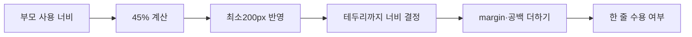

# 17. CSS 종합실습 — 두 칸의 크기와 줄바꿈 설명하기

[CSS 목차](README.md) · [작성 스타일](16_CSS_실무_코딩스타일.md)

각 속성을 외운 뒤에는 한 화면에서 서로 어떻게 연결되는지 확인해야 한다. 이번 종합실습은 수업의 display 실습을 읽고, 같은 원리를 **새로 구성한 전체 문서**에 적용한다. 먼저 요구사항만 보고 작성하고, 예상한 크기와 실제 배치를 비교한다.

<a id="chapter-toc"></a>

**순서:** [목표](#goals) → [조건](#setup) → [과제](#tasks) → [힌트](#hints) → [원본·정답](#solution) → [결과 풀이](#trace) → [변경·평가](#changes) → [TIP·복습](#review).

<a id="goals"></a>

## 1. 이번에 연결할 개념

두 칸이 나란히 놓이려면 **두 실제 너비 + 바깥 간격 + 사이 공백**이 부모 안에 들어가야 한다. 45%씩 두 개라고 무조건 한 줄인 것은 아니다. 최소 너비와 테두리·padding의 계산 기준까지 확인한다.

| 만들 기능 | 이미 배운 내용 | 완료 후 설명할 질문 |
| --- | --- | --- |
| 부모 가운데 | width·margin auto | 어느 영역 기준으로 가운데인가? |
| 두 칸 | inline-block·vertical-align | 한 줄에 실제로 들어가는가? |
| 칸 안 간격 | padding·border-box | 지정한 width 안에 포함되는가? |
| 좁은 화면 | min-width·줄바꿈 | 최소 너비가 언제 우선하는가? |
| 버튼 표현 | HTML button·hover | 시각 효과와 기능이 같은가? |

이 과제는 배운 inline-block 계산을 복습한다. Grid로 결과만 교체하는 것은 다른 추가 학습이며, 같은 원리를 설명한 답으로 대신하지 않는다.

<a id="setup"></a>

## 2. 실행 조건과 자료

[실행 HTML](실습/display_복습.html)을 브라우저로 연다. CSS는 내부 style에 있으며 외부 이미지·글꼴·JavaScript·서버 저장에 의존하지 않는다. GitHub에서 소스로 보이면 파일을 내려받아 실행한다.

body margin을 0으로 두므로 뷰포트 1000px일 때 부모 width90%를 900px로 계산할 수 있다. 화면 확인 시에는 창 전체의 바깥 너비와 페이지 뷰포트 너비를 구별한다. 스크롤 막대·브라우저 환경 때문에 실제 사용 가능 폭이 다른 경우 그 값을 먼저 기록한다.

**검증 표기:** 이 장의 수치는 아래 코드와 조건에서 계산한 예상이다. 이전 편집의 실행 기록을 이번 편집에서 다시 실행한 결과로 바꾸어 적지 않는다.

<a id="tasks"></a>

## 3. 정답 전에 작성할 요구사항

1. 부모는 너비 90%, 좌우 auto, 위아래 margin20px, 안쪽 위아래 padding20px다.
2. 직접 자식 두 칸은 inline-block·width45%·min-width200px·border-box다.
3. 각 칸은 border1px·padding20px이며 윗부분을 맞춘다.
4. 왼쪽 칸만 오른쪽 margin20px를 가진다. 두 칸 사이에는 HTML 줄바꿈 공백이 있다.
5. 왼쪽에는 큰 제목과 설명, 오른쪽에는 하위 제목·번호 목록·일반 버튼을 넣는다.
6. 부모 안의 두 칸은 가운데 모으고 각 칸 안 글자는 왼쪽으로 정렬한다.
7. 버튼의 hover 배경만 바꾼다. 클릭 후 화면 이동·저장 기능은 구현하지 않는다.

먼저 **부모 내용 너비가 900px인 경우와 360px인 경우**를 종이에 그린다. 각 칸의 테두리까지 너비, 내용 너비, 한 줄 수용 여부를 적는다. 원본 CSS를 읽을 때도 같은 순서로 계산한다.

<a id="hints"></a>

## 4. 막혔을 때 읽는 힌트

<details>
<summary>힌트 1 — border-box 계산</summary>

900px의 45%는 405px다. border-box이므로 이 405px 안에 padding 좌우40px와 border 좌우2px가 포함된다. 내용에는 얼마가 남을까? margin은 바깥이므로 그다음에 따로 더한다.

</details>

<details>
<summary>힌트 2 — 최소 너비</summary>

360px의 45%는 162px지만 min-width는200px다. 두 칸만 합쳐도400px여서360px 한 줄에 들어갈 수 없다. %를 사용했다는 사실만으로 모든 화면에 들어맞지는 않는다.

</details>

<details>
<summary>힌트 3 — 정렬의 대상</summary>

부모의 text-align:center는 안의 inline-block들을 가운데 모은다. 자식의 text-align:left는 자식 안 글자를 왼쪽으로 둔다. vertical-align:top은 나란한 상자의 윗부분을 맞추는 별도 설정이다.

</details>

<a id="solution"></a>

## 5. 실제 수업 코드에서 정답으로 연결하기

내 경로는 css/실습_tc, 강사님 경로는 css/실습이다. 양쪽 display1·display2 내용이 같으므로 내 폴더에 있다는 이유로 독립 구현한 시험 정답이라고 단정하지 않는다. 아래는 **내 원본 발췌**다.

### 원본 1 — 가운데 놓인 상자와 hover

출처: `D:/workspace/workspace_html/css/실습_tc/display1.html` 23–34행

```css
        #parent .d3{
            /* margin-top: 20px; */
            height: 40px;
            width: 200px;

            margin: 20px auto;
            
            background-color: rgba(250, 235, 215, 0.3);
        }
        #parent .d3:hover{
            background-color: rgba(250, 235, 215, 0.5);
        }
```

너비200px를 auto margin으로 가운데 둔다. 전체 선택자가 border1px도 주므로 테두리까지는202px다. hover의0.3→0.5는 **배경색 알파**이고 전체 opacity가 아니다. 원본은 div라 버튼처럼 보여도 다음 화면으로 이동하는 기능은 없다.

### 원본 2 — 두 칸의 크기

출처: `D:/workspace/workspace_html/css/실습_tc/display2.html` 23–35행

```css
        #wrapper .content {
            display: inline-block;
            /* width: 198PX; */
            width: 45%;
            min-width: 200px;
            box-sizing: border-box;

            vertical-align: top;
        }

        #wrapper .content.left{
            margin-right: 20px;
            /* font-size: 0; */
```

45%와 min-width200px, border-box는 함께 읽는다. 왼쪽 margin20px는 width 안에 들어가지 않는다. 강사님 코드는 같아 추가로 인용하지 않는다.

### 새 복습 예제 — 전체 파일

**원본 발췌가 아닌 설명용 재구성**이다. 원본 외부 이미지를 글 상자로 바꿔 배치 계산에 집중했다. 아래와 [실행 파일](실습/display_복습.html)은 같다.

<details>
<summary>완성 코드 — 먼저 작성한 뒤 비교</summary>

```html
<!DOCTYPE html>
<html lang="ko">
<head>
    <meta charset="UTF-8">
    <meta name="viewport" content="width=device-width, initial-scale=1.0">
    <title>CSS 수업 복습</title>
    <style>
        body { margin: 0; }
        .wrapper {
            width: 90%;
            margin: 20px auto;
            padding: 20px 0;
            background-color: #eeeeee;
            text-align: center;
        }
        .content {
            display: inline-block;
            width: 45%;
            min-width: 200px;
            box-sizing: border-box;
            border: 1px solid gray;
            padding: 20px;
            vertical-align: top;
            text-align: left;
        }
        .left {
            margin-right: 20px;
            background-color: #abcdef;
        }
        .right { background-color: white; }
        button {
            width: 120px;
            height: 40px;
            border: 1px solid gray;
            background-color: white;
        }
        button:hover { background-color: #abcdef; }
    </style>
</head>
<body>
    <div class="wrapper">
        <div class="content left">
            <h1>CSS 복습</h1>
            <p>박스 크기와 줄바꿈을 확인합니다.</p>
        </div>
        <div class="content right">
            <h2>확인할 내용</h2>
            <ol>
                <li>너비와 padding</li>
                <li>좌우 margin과 공백</li>
                <li>좁은 화면의 줄바꿈</li>
            </ol>
            <button type="button">연습 버튼</button>
        </div>
    </div>
</body>
</html>
```

</details>

<a id="trace"></a>

## 6. 입력 조건에서 결과까지 따라가기

| 계산 단계 | 부모 내용900px | 부모 내용360px |
| --- | --- | --- |
| width45% | 405px | 162px |
| min-width 반영 | 405px | 200px |
| 테두리까지 칸 너비 | 405px | 200px |
| 칸 내용 너비 | 405−40−2=363px | 200−40−2=158px |
| 두 칸과 왼쪽 margin | 810+20=830px | 400+20=420px |
| 공백을 더한 한 줄 수용 | 보통 수용 가능 | 이미 부모보다 커서 불가능 |

공백의 폭은 글꼴·크기에 따라 다르므로 고정4px라고 외우지 않는다. 900px 조건은 약70px의 여유에 공백이 들어갈 수 있어 나란히 놓인다. 360px에서는 공백을 없애도420px가360보다 커서 다음 줄로 내려간다. 원인은 공백 하나만이 아니다.

오른쪽 padding을 늘려도 border-box인 지정 너비 자체는 유지되고 내용 공간이 줄어든다. 충분히 작은 내용 공간에서 글줄·높이가 달라질 수 있으므로 너비 유지와 화면 모양 동일을 같은 말로 쓰지 않는다.



> 📚 **출처 · 본문 설명 확인:** [박스와 마진](https://www.w3.org/TR/CSS2/box.html), [box-sizing](https://www.w3.org/TR/css-sizing-3/#box-sizing), [인라인 배치](https://www.w3.org/TR/CSS2/visuren.html#inline-formatting). 수치·표·풀이 흐름은 위 수업 코드와 새 예제에 적용해 작성했다. 확인일: 2026-10-28.

<a id="changes"></a>

## 7. 변경 실험과 코드 평가

| 한 가지 변경 | 예상할 차이 | 확인할 원리 |
| --- | --- | --- |
| 왼쪽 margin20만0으로 | 필요한 가로 공간20px 감소 | 바깥 간격 |
| 원래 두 칸 padding만30px로 | 내용 너비20px씩 감소 | border-box |
| 원래 box-sizing만content-box로 | 지정 너비에 여백·테두리 추가 | 실제 너비 증가 |
| 원래 min-width만삭제 | 좁은 화면에서162px까지 가능 | 제한 조건 |

모든 실험은 원래 코드로 돌아가 한 조건만 바꾼다. 두 칸에 공통 적용한 선언 하나의 변경과 여러 조건 동시 변경을 구분한다.

**잘한 점:** 공통 content 규칙에 두 칸의 크기를 모아 비교하기 쉽다. **한계:** 최소200px보다 더 좁은 화면까지 완벽히 맞추는 설계는 아니다. **개선 방향:** 요구하는 최소 화면 너비를 정하고 그 조건에서 줄바꿈·가로 넘침을 확인한다. 새로운 반응형 설계는 배운 계산을 설명한 뒤 별도 과제로 확장한다.

div가 버튼처럼 보이는 것, button이 실제로 있는 것, 클릭 기능이 구현된 것은 서로 다른 단계다. 위 새 예제는 의미가 맞는 일반 button을 쓰지만 별도 클릭 이벤트는 없다. 이 차이를 주석과 문서에 정확히 남긴다.

<a id="review"></a>

## 8. 추가로 알면 좋은 것과 자기 점검

> 💡 **TIP · 수업 범위 밖:** 아래 프로젝트는 Grid·gap·focus-visible·spread·움직임 감소 조건을 더한 선택 학습이다. 기본 inline-block 복습의 필수 정답이 아니다. 코드와 실행 파일을 함께 두되 현재 수업 범위와 구분한다.

<a id="extra-04-1"></a>

### 먼저 예측하기

- 600px 이하에서는 한 열, 그보다 넓으면 두 열이다.
- 링크를 클릭하면 같은 문서의 복습 안내로 이동한다. 수강 기록 저장 기능은 없다.
- 카드에 포인터를 올리면 올라간다. 움직임 감소 선호가 켜져 있으면 이동·전환을 생략한다.

<details>
<summary>추가 프로젝트 전체 HTML</summary>

```html
<!DOCTYPE html>
<html lang="ko">
<head>
    <meta charset="UTF-8">
    <meta name="viewport" content="width=device-width, initial-scale=1.0">
    <title>학습 카드 추가 실습</title>
    <style>
        * { box-sizing: border-box; }
        body { margin: 0; color: #17253b; background: #f4f6fa; }
        .page { width: 90%; max-width: 900px; margin: 32px auto; }
        .cards {
            display: grid;
            grid-template-columns: repeat(2, minmax(0, 1fr));
            gap: 20px;
        }
        .card {
            padding: 24px;
            border: 1px solid #ccd3df;
            background: white;
            box-shadow: 0 4px 10px 1px #0001;
            transition: transform 0.2s;
        }
        .card:hover { transform: translateY(-4px); }
        a { color: #174da5; }
        a:focus-visible { outline: 3px solid #174da5; outline-offset: 4px; }
        @media (max-width: 600px) {
            .cards { grid-template-columns: minmax(0, 1fr); }
        }
        @media (prefers-reduced-motion: reduce) {
            .card { transition: none; }
            .card:hover { transform: none; }
        }
    </style>
</head>
<body>
    <div class="page">
        <h1>학습 카드</h1>
        <p>추가 기능을 하나씩 비교하는 연습입니다.</p>
        <div class="cards">
            <div class="card">
                <h2>HTML</h2>
                <p>문서 구조와 폼의 이름·값을 복습합니다.</p>
                <a href="#review">HTML 복습 안내</a>
            </div>
            <div class="card">
                <h2>CSS</h2>
                <p>박스 크기와 배치 기준을 복습합니다.</p>
                <a href="#review">CSS 복습 안내</a>
            </div>
        </div>
        <h2 id="review">복습 안내</h2>
        <p>예상한 값과 실제 화면이 다른 이유를 설명해 보세요.</p>
    </div>
</body>
</html>
```

</details>

[실행용 HTML](실습/학습카드_추가실습.html)을 내려받아 열 수 있다. 외부 이미지·글꼴·서버 저장에 의존하지 않는다.

<a id="extra-04-2"></a>

### 비교와 후속 과제

| 단계 | 확인할 결과 |
| --- | --- |
| Grid·gap | 두 카드의 열과 사이 간격. 좁은 화면에서 한 열 |
| 포커스 | Tab으로 링크에 도착할 때 표시되는 테두리 |
| 그림자 | spread·blur를 하나씩 바꾼 차이 |
| 전환 | 진입·이탈 모두 기본 규칙의 transition을 따르는지 |
| 움직임 감소 | 해당 선호 조건일 때 이동을 생략하는지 |

다크 모드를 추가한다면 배경만 바꾸지 말고 글자·링크·테두리·포커스 색을 함께 검토한다. 기존 대시보드의 진행률·알림은 실제 데이터와 연결하기 전에는 화면 예시다. JavaScript·서버 구현까지 이번 CSS 실습의 완료 기준에 포함하지 않는다.

움직임 감소는 사용자의 환경 조건이다. CSS 규칙이 있다는 사실과 그 조건을 켜고 실제로 검증했다는 주장은 구분한다. [미디어 조건 표준](https://www.w3.org/TR/mediaqueries-5/#prefers-reduced-motion)

**마지막 복습:** 코드 없이 다음을 말해 본다. ① 왜405px인가? ② 내용은 왜363px인가? ③360px 부모에서 왜 두 칸이 나뉘는가? ④공백을 없애면 항상 해결되는가? ⑤어디까지가 실제 수업 원본이며 어디부터 새 재구성인가?

<details>
<summary>짧은 답</summary>

900의45%이고, border-box 안의padding40·border2를 빼363이다. 360에서는 최소200짜리 두 개와margin20만으로420이어서 부족하다. 공백을 없애도 박스 자체가 넘치면 해결되지 않는다. 위 경로·행이 있는 두 발췌가 원본이고 전체 복습 문서는 새 예제다.

</details>

[장별 문제](실습/연습문제/README.md)로 약한 개념을 복습하고 [JavaScript](../03_JavaScript/README.md)로 이어 간다. CSS는 상태에 맞는 표현을 정하며, 이후 JavaScript에서는 실제 상태 변경과 이벤트 처리를 연결한다.

<!-- 이전 색인 이동 주소 보존 -->
<a id="section-1"></a>
<a id="section-2"></a>
<a id="section-3"></a>
<a id="section-4"></a>

[현재 목차로](#chapter-toc)
