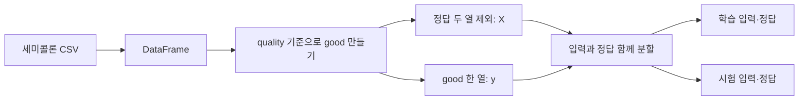

# 01. pandas — 와인 표를 읽고 문제와 정답을 따로 준비하기

[데이터 분석·머신러닝 목차](README.md) · [읽기 안내](00_데이터분석_읽기안내.md)

모델을 실행하기 전에 “한 행은 무엇이고, 무엇을 맞힐 것인가?”를 정해야 한다. 이 장에서는 표를 읽는 일부터 시작해 같은 와인의 입력과 정답이 짝을 유지한 채 학습·시험으로 나뉘는 과정까지 따라간다.

**이 장의 목차:** [목표](#learn) · [개념](#concepts) · [예제](#example) · [내 코드](#my-code) · [연결](#connections) · [평가](#review) · [비교](#teacher) · [결과·실험](#results) · [TIP·출처](#tips) · [복습](#practice)

<a id="learn"></a>

## 1. 이 장에서 배울 것

DataFrame·Series·행·열·특성·정답을 구별한다. 세미콜론 CSV를 확인하고 good을 만든 이유, quality와 good을 입력에서 뺀 이유, 네 분할 변수의 관계를 설명한다. 수업의 실제 와인 표와 아래 작은 가상 표의 숫자를 혼동하지 않는다.

<a id="concepts"></a>

## 2. 무엇이며, 왜 필요한가

### 표를 프로그램에서 다루면 무엇이 달라질까?

CSV는 값을 구분자로 나열해 저장한 텍스트 파일이다. pandas는 이 파일을 읽어 이름 있는 행·열 구조로 다룰 수 있게 한다. DataFrame은 표 전체에 해당하고, 그 표에서 `df['quality']`처럼 한 열을 고르면 보통 Series가 된다. Series는 값뿐 아니라 각 값의 행을 가리키는 인덱스도 가진다. 원본 주석의 Serial은 여기서 쓰는 pandas 이름이 아니다.

한 와인의 측정값을 입력으로 주고 “좋은 와인인가?”를 답으로 만들려고 한다. 그런데 CSV의 quality는 0·1이 아니라 품질 점수다. 수업에서는 **7 이상이면 1, 나머지는 0**이라는 새 기준을 정했다. 이 기준은 모델이 스스로 발견한 진리가 아니라 사람이 정한 분류 문제다. 0도 와인 데이터가 없다는 뜻이 아니라 정답 클래스 중 하나다.

| 이름 | 모양 | 이 수업에서의 의미 |
| --- | --- | --- |
| DataFrame | 여러 행·열 | 와인 표 또는 여러 입력 열 |
| Series | 한 축의 값과 인덱스 | quality나 good 한 열 |
| 특성·feature | 입력 열 | 산도·당도·알코올 같은 측정값 |
| 타깃·target | 맞힐 값 | 사람이 만든 good의 0·1 |
| X | 2차원 입력 | 실제 CSV에서는 측정값 11열 |
| y | 1차원 정답 | X의 각 행과 짝인 good |

### 답을 입력에서 빼는 이유

학생에게 시험 답을 함께 주면 맞힌 개수로 이해도를 판단하기 어렵다. 여기서 good은 정답 그 자체이고 quality는 그 정답을 만든 재료다. 둘 중 하나라도 X에 남기면, 측정값으로 품질을 예측한다는 원래 문제와 달라진다. `drop(columns=...)`로 두 열을 제외한 반환값을 X에 받는다. dataFrame 전체에서 열을 제자리 삭제한 것은 아니다.

### 왜 같은 표를 두 부분으로 나눌까?

학습에 사용한 행만 다시 맞혀 보면 처음 보는 행에서도 잘 맞히는지 알기 어렵다. train은 모델이 관계를 익히는 데 쓰고 test는 그 뒤 확인용으로 남긴다. X와 y를 별도로 제멋대로 섞으면 와인과 정답이 엇갈릴 수 있으므로 **한 번의 train_test_split에 함께 전달**한다. `stratify=y`는 클래스 비율을 비슷하게 유지하고, `random_state=42`는 분할의 무작위 선택을 비교하기 쉽게 고정한다. 42 자체가 더 높은 품질을 뜻하지는 않는다.

> 📚 **출처 · 본문 설명 확인:** [pandas read_csv](https://pandas.pydata.org/docs/reference/api/pandas.read_csv.html) · [train_test_split](https://scikit-learn.org/stable/modules/generated/sklearn.model_selection.train_test_split.html). 배운 의미 확인 근거다. 아래 표·전체 예제·풀이를 외부 문장 그대로 옮기지 않았다. 확인일: 2026-10-30.

<a id="example"></a>

## 3. 작은 예제로 먼저 이해하기

**새 설명 예제 · 필요한 파일 전체.** 같은 장의 폴더 구조를 유지한다. pandas와 scikit-learn이 필요하다. 새 연습 환경에서는 `python -m pip install pandas scikit-learn`로 준비할 수 있다. 이 작업의 검증은 기존 수업 환경을 읽기만 했다. 아래 두 파일을 같은 폴더에 저장하고 `python example.py`를 실행한다. tiny_wine.csv는 원본 와인 파일이 아니라 행과 정답의 짝을 보기 위해 새로 만든 10행·3열 자료다.


**[tiny_wine.csv](실습/책형_복습/01_Pandas_와인데이터와_학습입력/tiny_wine.csv) — 새 예제 전체 파일**

```csv
alcohol;acidity;quality
8.0;6.0;5
8.5;6.1;6
9.0;6.2;5
9.5;6.3;6
10.0;6.4;5
11.0;6.5;7
11.5;6.6;8
12.0;6.7;7
12.5;6.8;8
13.0;6.9;7
```

**[example.py](실습/책형_복습/01_Pandas_와인데이터와_학습입력/example.py) — 새 예제 전체 파일**

```python
import pandas as pd
from sklearn.model_selection import train_test_split

df = pd.read_csv('tiny_wine.csv', sep=';')
print('읽은 모양:', df.shape)
df['good'] = (df['quality'] >= 7).astype(int)
y = df['good']
X = df.drop(columns=['quality', 'good'])
X_train, X_test, y_train, y_test = train_test_split(
    X, y, test_size=0.2, random_state=42, stratify=y
)
print('정답:', y.tolist())
print('입력 열:', X.columns.tolist())
print('원본 열:', df.columns.tolist())
print('분할 크기:', len(X_train), len(X_test), len(y_train), len(y_test))
print('학습 짝:', X_train.index.equals(y_train.index))
print('시험 짝:', X_test.index.equals(y_test.index))
print('시험 클래스:', sorted(y_test.tolist()))
```

첫 줄은 CSV를 읽은 직후이므로 3열이다. good을 추가하면 df는 4열이 된다. X는 두 정답 관련 열을 뺀 2열이고, 원본 df는 여전히 quality와 good을 가지고 있다. 마지막 검사는 값을 맞혔다는 평가가 아니라 **입력과 정답의 인덱스가 같은 순서인지** 보는 것이다.

`tolist()`·`columns`·`index.equals()`는 이 새 예제의 확인을 돕는 표기다. 당시 원본에 사용한 것처럼 인용하지 않는다. 8행을 학습, 2행을 시험으로 나누고 두 시험 행에는 0과 1이 하나씩 있다. 수업 CSV의 실제 비율은 이 가상 자료의 5:5와 다르다.

**실행 결과:**

```text
읽은 모양: (10, 3)
정답: [0, 0, 0, 0, 0, 1, 1, 1, 1, 1]
입력 열: ['alcohol', 'acidity']
원본 열: ['alcohol', 'acidity', 'quality', 'good']
분할 크기: 8 2 8 2
학습 짝: True
시험 짝: True
시험 클래스: [0, 1]
```

<a id="my-code"></a>

## 4. 내가 작성한 코드를 따라 읽기

### 내 코드 — 원본

출처: `D:/workspace/workspace_python/06_scikit_learn/01_main.py` 12–30행 · **원본 발췌**

```python
import pandas as pd 

# dataFrame은 2차원 배열을 뜻 함
dataFrame = pd.read_csv('wine+quality/winequality-red.csv', sep=';')

# head()로 기본 상위 5줄의 값을 출력하여 테스트 함, 전달인자 넣어서 3줄만 볼 수도 있음
# head의 경우 대충 hello world 느낌으로 로딩이 잘 되었는지 찍어보는 것
print(dataFrame.head(3))
print('-'*30)

# shape : 데이터프레임의 크기를 표시(행,열 의 개수)
# 보통 column을 변수라고 얘기하기도 함
print('dataFrame.shape : ', dataFrame.shape) 
print('-'*30)

# info : 데이터프레임의 요약 정보
# 출력결과 : 데이터 개수, 컬럼 이름, 결측치(null) 유/무, 타입, 메모리 사용량 
# 전체 column에 null이 없고 float, int로 되어있는 분석정보가 나옴
dataFrame.info() # memory usage: 150.0 KB 는 실제 메모리 사용량
```

**발췌 바로 풀이:** read_csv는 파일을 읽어 반환한 표를 dataFrame에 넣는다. head(3)은 표의 앞부분을 반환하고 print가 이를 보여 준다. info()는 요약을 직접 출력한다. DataFrame을 단순한 2차원 리스트와 같은 객체로 생각하기보다 이름·자료형·인덱스가 있는 표로 읽는다. memory usage는 해당 객체의 메모리 추정 표시이며 프로그램 전체나 CSV 파일 크기를 뜻하지 않는다.
### 내 코드 — 원본

출처: `D:/workspace/workspace_python/06_scikit_learn/01_main.py` 33–43행 · **원본 발췌**

```python
# 정답 데이터 만들기 / (dataFrame['quality'] >= 7) 의 결과인 True는 1, False는 0으로 바꾸어 줌 (astype)
dataFrame['good'] = (dataFrame['quality'] >= 7).astype(int)
y = dataFrame['good'] # y는 정답
# quality는 점수로 되어있는데, 이를 단순화 시켜서 0과 1로 구분하기 위해 위 작업 진행
# 데이터 전처리(정제하는 과정 등), feature engineering
# 데이터 분석 전에 불순물, 이상치 제거

# 문제 데이터 만들기
X = dataFrame.drop(
    columns=['quality', 'good'] # 두 column을 지워서 X에 넣어라
)
```

**발췌 바로 풀이:** quality 열의 각 원소에 비교가 적용되어 참·거짓 열이 생기고 astype(int)가 이를 1·0으로 바꾼다. y는 good 열이다. drop의 결과를 X로 받으므로 원래 표에서 정답 열을 지웠다는 뜻은 아니다. 이 코드가 실제로 하는 전처리는 정답 기준 정의와 입력 분리이며, 주석에 결측·이상치 제거가 있다고 제거를 수행한 것은 아니다.
### 내 코드 — 원본

출처: `D:/workspace/workspace_python/06_scikit_learn/01_main.py` 51–57행 · **원본 발췌**

```python
from sklearn.model_selection import train_test_split
X_train, X_test, y_train, y_test = train_test_split(
    X, y,
    test_size = 0.2, # 문제와 정답을 준 뒤 20퍼센트만 가지고 테스트하라는 것, 80퍼센트 학습
    random_state = 42, # 다른 숫자를 사용해도 되지만, 같은 값을 사용해야 결과도 같다
    stratify = y # 80%의 학습용 데이터에서 7(좋음):3(나쁨) 이라면 y의 정답데이터도 해당 퍼센트로 잡아라
)
```

**발췌 바로 풀이:** 네 반환 순서는 X_train, X_test, y_train, y_test다. 각 입력·정답을 같은 기준으로 나눈다. 7:3은 주석의 비유이며 실제 CSV의 클래스 비율이 아니다. random_state를 바꾸면 분할이 바뀔 수 있지만 모든 환경·버전 차이를 없애는 보장은 아니다.

실제 두 CSV는 1,599행·12열이고 quality 외 측정값은 11열이다. good을 추가한 전체 표는 13열, X는 11열, y는 1,599개의 정답이 된다. `quality >= 7`인 행은 217개다. 20% 시험 분할 결과는 학습 1,279행, 시험 320행이다. 두 입력에 같은 순서의 정답이 붙어 있어야 한다.

원본의 “깊은 복사” 메모는 이 작업의 목표를 설명하기에 범위가 크다. 우선 정확히 확인할 것은 **drop의 반환값을 받았으며 원본의 열을 제자리 변경하지 않았다**는 점이다. pandas 내부 공유·복사의 모든 규칙까지 이 줄로 일반화하지 않는다.

<a id="connections"></a>

## 5. import·함수·입력·출력이 연결되는 흐름



`import pandas as pd`의 pd는 라이브러리에 붙인 별칭이다. 직접 작성한 별도 def를 import한 구조는 아니다. train_test_split은 sklearn.model_selection에서 가져온 함수로, 짝인 두 자료와 설정을 받아 네 자료를 돌려준다. 학습 입력·정답은 다음 장의 fit으로 연결되고 시험 입력·정답은 평가 장까지 보관한다. CSV의 상대 경로는 실행하는 작업 폴더를 기준으로 찾으므로 원본은 06_scikit_learn 폴더에서 실행해야 한다.

<a id="review"></a>

## 6. 잘한 점·아쉬운 점·개선 방향

**잘한 점:** 불러오자마자 head·shape·info를 확인하고, X와 y를 이름으로 나눠 기록했다. 모델 오류를 보기 전에 파일과 열의 문제를 먼저 찾을 수 있는 순서다. 입력과 정답을 함께 분할하고 클래스 비율도 고려했다.

**아쉬운 점:** “DataFrame은 2차원 배열”, “깊은 복사”, “전처리는 불순물 제거” 같은 짧은 메모는 시간이 지나면 서로 다른 개념을 하나로 기억하게 할 수 있다. 표의 구조, 반환값, 실제 수행한 변경을 구체적으로 적으면 좋다.

**이렇게 개선하면 좋다:** 출력 옆에 “원래 12열 → good 추가 13열 → X 11열”을 남긴다. 이름에 input/target 역할을 메모하고 원본·학습·시험의 크기도 함께 기록한다. 지금 문서는 새 확인 예제로 이 관계를 검증하되 원본 파일은 바꾸지 않았다.

원본 오류·수업용 단순화·목적에 따른 설계를 나눈다. 새 개선안은 당시 내 코드나 D 드라이브 수정본이 아니다.

<a id="teacher"></a>

## 7. 강사님 코드가 도움이 되는 비교


두 원본의 실제 읽기·정답 생성·분할 인자는 같다. 공백과 주석 길이의 차이를 우열로 평가할 필요가 없어 강사님 코드를 다시 붙이지 않았다. 같은 목적을 더 정확한 설명과 현재 자료의 수치로 풀어 썼다.

<a id="results"></a>

## 8. 결과를 추적하고 한 가지 바꾸기

| 지점 | 원본 CSV 기준 모양 | 다음에 쓸 곳 |
| --- | --- | --- |
| 읽기 직후 | 1,599 × 12 | 요약 확인 |
| good 추가 | 1,599 × 13 | 입력·정답 분리 |
| X / y | 1,599 × 11 / 1,599개 | 짝인 분할 |
| X_train / y_train | 1,279 × 11 / 1,279개 | fit |
| X_test / y_test | 320 × 11 / 320개 | predict와 평가 |

정답이 있다는 말은 모든 측정값이 정확하다는 품질 보장이 아니다. 이 장에서는 우선 실제 파일의 모양과 정답 기준을 분명히 확인한다.

실제 분할에서 정답 0은 학습 1,105개·시험 277개, 정답 1은 학습 174개·시험 43개다. 정확히 같은 비율의 소수 행을 나눌 수는 없으므로 가까운 정수 개수로 나뉜다. 학생 CSV는 LF, 강사님 CSV는 CRLF여서 파일 바이트 크기와 해시는 다르지만 정규화한 텍스트와 읽은 표는 같다. 이는 모델 자료가 달랐다는 뜻이 아니다.

| 한 가지만 변경 | 확인할 결과 | 해석 |
| --- | --- | --- |
| 새 CSV에서 sep 생략 | 보통 한 열로 읽힘 | 파일 구분자와 맞지 않음 |
| good 기준을 8로 변경 | 7점 행은 0으로 바뀜 | 문제 정의가 달라짐 |
| X에서 good을 빼지 않음 | 정답 열이 입력에 남음 | 분류 시험의 의미가 달라짐 |
| random_state만 변경 | 같은 크기라도 선택 행이 바뀔 수 있음 | 분할과 크기는 다른 개념 |

파일을 못 찾으면 Python 파일 위치와 현재 작업 폴더를 구별한다. quality 열을 못 찾으면 먼저 columns와 구분자를 본다. stratify 오류가 나면 작은 자료의 클래스 개수와 시험 크기가 충분한지 확인한다. info를 print로 다시 감싸면 요약 뒤 None이 보일 수 있는데, info가 요약을 출력하고 반환한 값 때문이다.

**확인 범위:** 작은 새 예제를 임시 폴더에서 독립 실행해 위 출력을 확인한다. 원본 CSV의 모양·분할·모델 결과 검사는 별도 보고서에 기록한다. 원본 주석의 옛 점수와 이번 실행값을 구별한다. 기존 수업 가상환경과 D 드라이브 소스는 읽기만 하며 새 패키지나 생성물을 쓰지 않는다.

<a id="tips"></a>

## 9. 추가로 알면 좋은 것과 출처

> 💡 **TIP · 수업 범위 밖:** 결측치 대체·범주형 인코딩·Pipeline·복사와 내부 메모리 공유의 상세 규칙은 추가 학습이다. 이 장에서 만든 good은 교육용 분류 기준이며 와인의 실제 시장 가치나 건강·안전 판단을 뜻하지 않는다.

확인한 라이브러리 의미와 수업 밖 확장을 구분한다. 위 출처는 본문의 설명 근거이며 TIP에 적힌 새 주제를 이미 배운 것으로 간주하지 않는다.

<a id="practice"></a>

## 10. 복습과 빠른 정리

1. good을 만들고도 quality를 X에서 빼는 이유는?
2. stratify와 random_state는 각각 무엇을 정하는가?
3. 실제 CSV의 분할 크기와 가상 CSV의 분할 크기는?

<details>
<summary>풀이 — 먼저 결과와 이유를 적은 뒤 펼치기</summary>

1. quality로 good을 바로 계산할 수 있어 정답의 근거가 입력에 남기 때문이다.
2. 정답 클래스의 비율과 무작위 분할의 재현 조건이다.
3. 실제는 1,279/320, 가상은 8/2다. 각각의 입력과 정답은 같은 행을 가리킨다.

</details>

| 빠른 찾기 | 기억할 내용 |
| --- | --- |
|shape | 행 수, 열 수 |
|head(3) | 앞 3행 |
|good | quality 7 이상이면 1 |
|drop | 반환값을 X에 받음 |
|split | 입력·정답의 짝을 함께 유지 |

[장별 연습문제](실습/연습문제/01_Pandas_와인데이터와_학습입력_연습문제.md) · [다음: 모델 학습과 예측](02_RandomForest_학습과_예측.md)
