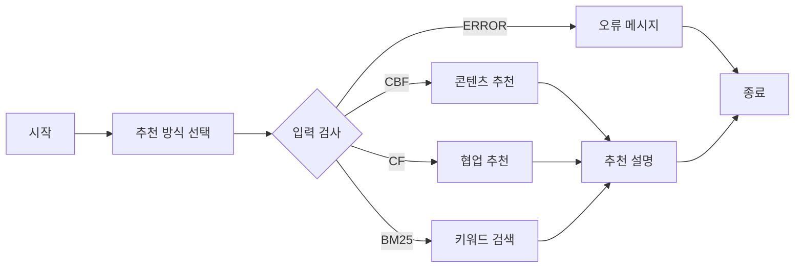

# StateGraph에서 추천 경로를 분기하기

[단원 목차](README.md) · [연습문제](실습/연습문제/04_StateGraph와_조건분기_연습문제.md) · [이전](03_영화추천결과_설명체인.md) · [다음](05_추천노드와_최종상태.md)

<a id="learn"></a>

## 1. 이 장에서 배울 것

State, 노드, 간선의 역할과 `compile()`·`invoke()`를 설명한다. 분류 결과와 입력 검증이 어떤 경로를 선택하는지 추적한다.

<a id="concepts"></a>

## 2. 무엇이며, 왜 필요한가

State는 여러 단계가 공유하는 자료다. 노드는 그 자료를 읽어 작업하고 바뀐 필드를 반환한다. 일반 간선은 다음 단계가 고정되고, 조건 간선은 판정 결과를 노드 이름에 연결한다. 현재 실습은 질문 분류 → 필수 입력 확인 → 추천 또는 오류 → 종료의 흐름이다.



<a id="example"></a>

## 3. 작은 예제로 먼저 이해하기

**설명용 전체 예제.** [실행 파일](실습/책형_복습/04_StateGraph와_조건분기/example.py)을 해당 장의 Python 환경으로 실행한다. 모든 입력과 모델 대역은 복습용이며 외부 서비스에 요청하지 않는다.

```python
from typing import TypedDict
from langgraph.graph import END, START, StateGraph


class State(TypedDict, total=False):
    movie_ids: list[int]
    route: str
    result: str


def select(_state):
    return {'route': 'CBF'}


def validate(state):
    return 'CBF' if state.get('movie_ids') else 'ERROR'


graph = StateGraph(State)
graph.add_node('select', select)
graph.add_node('cbf', lambda state: {'result': f"후보 입력 {state['movie_ids']}"})
graph.add_node('error', lambda _state: {'result': '영화 ID가 필요합니다'})
graph.add_edge(START, 'select')
graph.add_conditional_edges('select', validate, {'CBF': 'cbf', 'ERROR': 'error'})
graph.add_edge('cbf', END)
graph.add_edge('error', END)
app = graph.compile()
for input_state in ({'movie_ids': [10]}, {}):
    print(app.invoke(input_state)['result'])
```

**실행 결과**

```text
후보 입력 [10]
영화 ID가 필요합니다
```

<a id="my-code"></a>

## 4. 내 폴더의 실제 코드 읽기

**원본 발췌 · D:/workspace/workspace_python/08_langgraph/router/langgraph_router.py 234–284행**

```python
@router.post('/langgraph/recommend')
def recommend(param: State):
    print(param)
    # question = param.question

    # langgraph 생성
    graph = StateGraph(State)

    # langgraph용 node 등록
    graph.add_node('select', recommend_select)
    graph.add_node('CBF', cbf)
    graph.add_node('CF', cf)
    graph.add_node('BM25', bm25)
    graph.add_node('explain', explain)

    graph.add_node('validator', validator)
    graph.add_node('makeErrorMessage', makeErrorMessage)

    # node간의 edge설정
    graph.add_edge(START, 'select')

    graph.add_conditional_edges(
        'select',
        # lambda s: s.recommend_type,
        'validator',
        {
            'CBF': 'CBF',
            'CF': 'CF',
            'BM25': 'BM25',
            'ERROR': 'makeErrorMessage'
        }
    )

    graph.add_edge('CBF', 'explain')
    graph.add_edge('CF', 'explain')
    graph.add_edge('BM25', 'explain')

    graph.add_edge('explain', END)
    graph.add_edge('makeErrorMessage', END)

    # 실행 가능한 langgraph객체로 만들기
    recommend_graph = graph.compile()
    result = recommend_graph.invoke({
        'list_movieId' : param.list_movieId,
        'userId' : param.userId,
        'top_k' : param.top_k,
        'question' : param.question,
        'recommedns': []
    })

    return result
```

**의도한 흐름:** `START`에서 `select`를 실행한 뒤 판정값 `CBF`, `CF`, `BM25`, `ERROR`로 다음 노드를 고른다. 추천 경로에서만 `explain`으로 이어진다.

**실행 확인:** 수업 환경의 LangGraph 1.2.16에서 두 원본은 `add_conditional_edges()`에 문자열 `'validator'`를 넘겨 `TypeError`가 난다. 호출할 함수 객체를 전달해야 분기 등록이 진행된다. `add_node('validator', validator)`로 이름을 등록하는 동작은 조건 간선의 판정 함수 연결과 별개다.

```python
# 설명용 수정 예시
graph.add_conditional_edges(
    'select', validator,
    {'CBF': 'CBF', 'CF': 'CF', 'BM25': 'BM25', 'ERROR': 'makeErrorMessage'},
)
```

위처럼 판정 함수로 사용한다면 별도로 등록한 `validator` 노드는 연결할 필요가 없다. 3절 예제도 함수 `validate`를 직접 전달한다.

<a id="connections"></a>

## 5. import·함수·입력·출력이 연결되는 흐름

`api.py`에서 LangGraph 라우터를 등록한다. 분기 인자를 수정한 흐름에서 `recommend_select()`가 `RecommendType`에 맞춰 분류 결과와 이유를 State에 기록한다. `validator()`는 CBF의 영화 ID 목록과 CF의 사용자 ID가 있는지 보고 다음 경로를 정한다. 오류 경로는 `makeErrorMessage()`가 `error`를 채운다.

<a id="review"></a>

## 6. 잘한 점·아쉬운 점·개선 방향

**잘한 점.** 분류에 모델을 쓰고 필수 입력 검사는 함수로 분리했다. 분기와 종료를 읽으면 모델 없이도 결과 경로를 예상할 수 있다.

**아쉬운 점.** 원본 CBF 입력 검사는 `None`만 검사해 빈 목록을 허용한다. 위 복습 예제는 빈 목록도 차단한다. `ERROR` 경로는 State의 `error` 필드를 채우므로 HTTP 상태 코드와 응답 계약이 필요하다면 별도로 정의할 수 있다.

<a id="teacher"></a>

## 7. 강사님 코드가 도움이 되는 비교

판정 함수를 문자열로 전달하는 오류는 양쪽 코드에 있다. 초기 상태는 강사님이 `recommends`를 넘기고 내 코드는 `recommedns`로 적었다. 선언된 State 필드와 맞추는 강사님 코드가 읽기 쉽다. 내 State에는 `recommends` 기본값이 있어 일부 결과만 봐서는 오타를 알아채기 어렵다.

<a id="results"></a>

## 8. 결과를 추적하고 한 가지 바꾸기

`{}`는 `START → select → ERROR → error → END`를 타고 `[10]`은 `cbf`로 간다. `movie_ids=[]`를 한 건 더 넣고 복습 예제와 수업 원본의 빈 목록 처리 차이를 말한다.

<a id="tips"></a>

## 9. 추가로 알면 좋은 것과 출처

> 💡 **추가로 알면 좋은 것:** 재시도·상태 저장·실행 추적을 추가할 수 있다. LangSmith는 메모에 있지만 확인한 수업 코드의 실행 예제로 다루지 않는다.

📚 [LangGraph Graph API](https://docs.langchain.com/oss/python/langgraph/graph-api)

<a id="practice"></a>

## 10. 복습과 빠른 정리

1. `compile()`과 `invoke()`는 각각 무엇을 하는가?
2. `select` 뒤에서 영화 목록이 없는 CBF 요청은 어디로 가는가?

[풀이를 접어 둔 연습문제](실습/연습문제/04_StateGraph와_조건분기_연습문제.md)에서 확인한다.

[단원 목차](README.md) · [연습문제](실습/연습문제/04_StateGraph와_조건분기_연습문제.md) · [이전](03_영화추천결과_설명체인.md) · [다음](05_추천노드와_최종상태.md)
